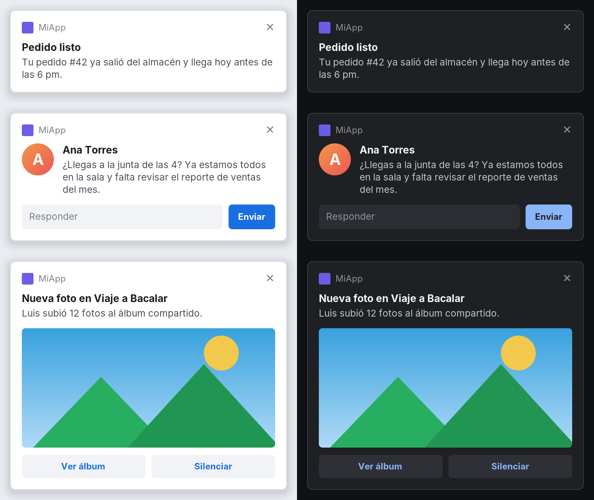

# kmp-desktop-push

### Notificaciones push de Firebase Cloud Messaging (FCM) para Kotlin Multiplatform y Compose Desktop

[English](README.md) · **Español**

Notificaciones push para apps KMP de escritorio en Windows, macOS y Linux: un token FCM real, entrega en tiempo real y notificaciones enriquecidas con imágenes, botones y respuesta rápida.

Firebase no tiene SDK de mensajería para desktop. Esta librería hace lo mismo que hace Chrome cuando una web se suscribe a push: registra el equipo en FCM, obtiene un **token FCM normal** y mantiene un socket abierto con `mtalk.google.com` para recibir los mensajes. Tu backend le manda al token de desktop igual que a los de Android e iOS.

- Token FCM real (`messages:send` de la API HTTP v1, Admin SDK, consola de Firebase).
- Recibe `notification` y `data`, descifra el payload (Web Push `aesgcm` y `aes128gcm`).
- Notificaciones enriquecidas incluidas: imagen grande, avatar, botones y respuesta rápida, en tema claro y oscuro.
- Muestra la notificación nativa (Windows, macOS, Linux) o te deja pintarla tú.
- El token se conserva entre ejecuciones; reconexión automática con backoff.
- Dependencias: solo `kotlinx-coroutines-core` y `kotlinx-serialization-json`. Requiere JDK 11+.

## 1. Configurar Firebase

1. Consola de Firebase → Configuración del proyecto → **Tus apps** → agrega una app **Web** (`</>`). Copia `projectId`, `appId` y `apiKey`.
2. En Google Cloud → APIs y servicios → Credenciales, revisa esa API key: debe permitir **Firebase Installations API** y **FCM Registration API**, y no tener restricción de referrer HTTP, Android o iOS (desde desktop no se puede cumplir ninguna).

No necesitas clave VAPID: si no pasas `vapidKey` se usa la de FCM por defecto.

## 2. Instalar

Se publica con [JitPack](https://jitpack.io/#eliasmp07/kmp-desktop-push). Agrega el repositorio:

```kotlin
// settings.gradle.kts
dependencyResolutionManagement {
    repositories {
        mavenCentral()
        maven("https://jitpack.io")
    }
}
```

Y la dependencia en el source set de desktop:

```kotlin
// build.gradle.kts de tu módulo compartido
kotlin {
    sourceSets {
        val desktopMain by getting {          // o jvmMain, según el nombre de tu target
            dependencies {
                implementation("com.github.eliasmp07:kmp-desktop-push:v0.3.1")
            }
        }
    }
}
```

## 3. Usar

```kotlin
val fcm = FcmDesktop(
    options = FirebaseDesktopOptions(
        projectId = "tu-proyecto",
        appId = "1:1234567890:web:abc123",
        apiKey = "AIza...",
    ),
    config = FcmDesktopConfig(appName = "MiApp"),
)

// El token: mándalo a tu backend cada vez que emita (puede cambiar).
scope.launch { fcm.token.filterNotNull().collect { token -> api.registerPushToken(token, platform = "desktop") } }

// Los mensajes (suscríbete antes de start(); no hay replay).
scope.launch {
    fcm.messages.collect { message ->
        println("${message.notification?.title} -> ${message.data}")
    }
}

fcm.start()      // registra (la primera vez) y se queda escuchando
// fcm.stop()    // corta la conexión
// fcm.deleteToken()  // al cerrar sesión: borra el token en FCM y en disco
// fcm.close()   // al salir de la app
```

`fcm.connectionState` expone `Stopped / Registering / Connecting / Connected / WaitingToReconnect` por si quieres mostrarlo.

### Con Compose Desktop

```kotlin
fun main() = application {
    val trayState = rememberTrayState()
    val fcm = remember {
        FcmDesktop(
            options = FirebaseDesktopOptions(projectId = "...", appId = "...", apiKey = "..."),
            config = FcmDesktopConfig(appName = "MiApp"),
            // Usa el tray de Compose en lugar del notificador por defecto.
            notifier = DesktopNotifier { n -> trayState.sendNotification(Notification(n.title, n.body)) },
        )
    }
    DisposableEffect(Unit) {
        fcm.start()
        onDispose { fcm.close() }
    }
    Tray(state = trayState, icon = painterResource("icon.png"))
    Window(onCloseRequest = ::exitApplication) { App() }
}
```

### Encajarlo con Android/iOS

Define en `commonMain` la interfaz que ya uses para el token y los mensajes, e impleméntala en `desktopMain` sobre `FcmDesktop`:

```kotlin
// commonMain
interface PushService {
    val token: Flow<String>
    fun start()
}

// desktopMain
class DesktopPushService(private val fcm: FcmDesktop) : PushService {
    override val token: Flow<String> = fcm.token.filterNotNull()
    override fun start() = fcm.start()
}
```

### Notificaciones

Los mensajes con bloque `notification` se muestran solos. Hay tres formas de mostrarlos:

| Opción | Cómo | Cómo se ve | Imágenes, botones, respuesta | Historial del sistema y "no molestar" |
|---|---|---|---|---|
| Por defecto | sin configurar nada (`SystemDesktopNotifier`) | globo básico del sistema | no | depende del sistema |
| Enriquecida, de la app | `RichDesktopNotifier(center)` | tarjetas dibujadas por la librería, iguales en todos lados | sí | no |
| Enriquecida, nativa | lo mismo, con `backend = NotificationBackend.Native` | toasts de Windows / notificaciones del escritorio en Linux | sí | sí |

Las dos últimas están en [Notificaciones enriquecidas](#notificaciones-enriquecidas). La opción por defecto usa:

| SO | Cómo |
|---|---|
| Windows | `java.awt.SystemTray` (agrega un icono al tray; pásale el tuyo con `trayIcon` o `icon`) |
| macOS | Centro de notificaciones vía `osascript` (aparece a nombre de "Script Editor") |
| Linux | `notify-send`; si no está, el tray |

Para controlar la UI pasa tu propio `DesktopNotifier`, o `notifier = null` y pinta desde `fcm.messages`. Los mensajes solo-`data` nunca muestran nada.

## Notificaciones enriquecidas

`java.awt.TrayIcon` solo muestra un título y una línea de texto. La librería trae su propio centro de notificaciones, dibujado por la app, con lo que tienen las de Android: imagen grande, avatar, botones de acción y respuesta rápida. Se ve igual en Windows, macOS y Linux.

<p align="center"></p>

```kotlin
val center = DesktopNotificationCenter(
    NotificationCenterConfig(appName = "MiApp", appIcon = NotificationImage.Resource("icon.png")),
)

center.show(
    RichNotification(
        title = "Ana Torres",
        body = "¿Llegas a la junta de las 4?",
        largeIcon = NotificationImage.Url("https://example.com/ana.png"),
        image = NotificationImage.Url("https://example.com/foto.jpg"),
        actions = listOf(
            NotificationAction("Abrir chat") { openChat("ana") },
            NotificationAction("Silenciar") { mute("ana") },
        ),
        reply = NotificationReply(placeholder = "Responder", sendLabel = "Enviar") { texto -> chat.send("ana", texto) },
        onClick = { openChat("ana") },
    )
)
```

Sirve sola para notificaciones locales, y se conecta a FCM con `RichDesktopNotifier`:

```kotlin
val fcm = FcmDesktop(
    options = options,
    notifier = RichDesktopNotifier(center) { push ->
        // Título, cuerpo y `notification.image` ya vienen mapeados; agrega lo que necesite el push.
        RichDesktopNotifier.defaultNotification(push).copy(
            reply = NotificationReply { texto -> chat.send(push.message.data["chatId"], texto) },
        )
    },
)
```

| Función | Cómo |
|---|---|
| Imagen grande | `image` |
| Avatar | `largeIcon`, se muestra redondo |
| Icono y nombre de la app | `icon` / `appName`, o una vez en `NotificationCenterConfig` |
| Botones | hasta tres `NotificationAction`; `dismissOnClick = false` la deja abierta |
| Respuesta rápida | `NotificationReply`; se envía con Enter o con el botón |
| Actualizar | `show()` otra vez con el mismo `id` |
| Cerrar | `center.dismiss(id)`, `center.dismissAll()` |
| Duración | `timeoutMillis` (`0` = fija); se pausa con el cursor encima o al escribir una respuesta |
| Resultado | `onDismiss` informa `Timeout`, `Closed`, `Clicked`, `Action`, `Replied` o `Cancelled` |
| Apariencia | `theme` (claro, oscuro, sistema), `accentColor`, `position`, `width`, `maxVisible` |

Las imágenes pueden venir de una URL, un archivo, un recurso del classpath, bytes o una imagen AWT. Se cargan en segundo plano; las descargas se limitan a `http(s)`, 5 MB y 10 segundos. Los push con la misma collapse key se reemplazan entre sí, como los tags de Android.

A tener en cuenta:

- Los callbacks corren en el hilo de eventos de AWT. Lanza una corrutina para lo que tarde.
- Las ventanas de la app se muestran en la pantalla principal.

### Notificaciones del sistema: historial y "no molestar"

Por defecto las notificaciones son ventanas dibujadas por la librería. Con `backend = NotificationBackend.Native` se entregan al sistema operativo, así que aparecen en su historial de notificaciones y respetan el modo "no molestar" / concentración:

```kotlin
val center = DesktopNotificationCenter(
    NotificationCenterConfig(
        appName = "MiApp",
        appIcon = NotificationImage.Resource("icon.png"),
        backend = NotificationBackend.Native,
    ),
)
```

La misma `RichNotification` sirve con los dos backends. Qué puede mostrar cada sistema:

| | Windows 10/11 | Linux (GNOME, KDE Plasma, ...) | macOS |
|---|---|---|---|
| Las muestra | notificaciones toast | servicio de notificaciones de freedesktop.org | ventanas de la app |
| Historial y "no molestar" | sí | sí | no |
| Imagen grande, avatar | sí | una imagen (gana la grande) | sí |
| Botones | sí | sí | sí |
| Respuesta rápida | sí | solo KDE Plasma; en el resto esa notificación usa ventana de la app | sí |
| Reemplazar por `id`, `dismiss` | sí | sí | sí |

Lo que el sistema no puede mostrar cae a la ventana de la app, así que no se pierde nada: todo en macOS (ahí las notificaciones nativas enriquecidas requieren un bundle firmado y código nativo) y lo que no soporte el escritorio de Linux.

Diferencias con el backend de la app:

- Las dibuja el sistema: `theme`, `position`, `width`, `accentColor` y `maxVisible` no aplican, y el sistema decide cuánto dura el banner. `timeoutMillis = 0` pide uno persistente.
- En Windows, cualquier botón cierra el toast, así que `dismissOnClick = false` no tiene efecto. `onDismiss` no se llama cuando el banner solo se oculta, porque el toast sigue en el centro de notificaciones.
- Windows necesita que la app esté registrada: en el primer uso la librería escribe una clave de registro del usuario (`HKCU\Software\Classes\AppUserModelId\<appId>`) con el nombre y el icono. Pasa `appId` para usar el AppUserModelID del acceso directo de tu instalador.
- Los toasts de Windows pasan por un proceso oculto de Windows PowerShell que vive mientras viva el centro.
- Botones y respuestas solo funcionan con la app abierta. Después las notificaciones siguen en el historial pero ya no hacen nada.
- Linux necesita una JVM con sockets Unix (JDK 16+); con JVMs anteriores se usan las ventanas de la app.

> [!NOTE]
> El backend de Linux está probado contra un bus D-Bus real. El de Windows no se pudo ejecutar en Windows antes de publicar: el XML del toast tiene pruebas, el helper de PowerShell no. Reporta lo que veas.

## Enviar desde el backend

Igual que a cualquier token (API HTTP v1):

```json
{
  "message": {
    "token": "<token de desktop>",
    "notification": { "title": "Pedido listo", "body": "Tu pedido #42 ya salió" },
    "data": { "orderId": "42" },
    "webpush": { "headers": { "TTL": "86400", "Urgency": "high" } }
  }
}
```

Topics: el token de desktop no se puede suscribir desde el cliente; suscríbelo desde el servidor con el Admin SDK (`subscribeToTopic`).

## Límites que conviene saber

- **No es una API oficial.** Usa el protocolo de Chrome (check-in, `register3`, Firebase Installations, FCM Registration y MCS). Google puede cambiarlo; ya retiró la API de registro anterior en junio de 2024.
- **Solo recibe con la app abierta.** Lo enviado mientras está cerrada llega al volver a conectar, si no venció su TTL.
- **Red:** conexión TLS directa a `mtalk.google.com` por el puerto 5228, con 443 como alternativa. No pasa por proxies HTTP corporativos.
- **Clave VAPID propia:** el camino con `vapidKey` no está probado; usa la de por defecto salvo que la necesites.
- El archivo de registro (`fcm-registration.json` en la carpeta de configuración del usuario) contiene las claves privadas del dispositivo. Para guardarlo en otro lado implementa `CredentialStore`.

## Solución de problemas

### Primero activa el diagnóstico

```kotlin
val fcm = FcmDesktop(options, logger = FcmLogger.Verbose)
```

`FcmLogger.Verbose` imprime cada trama que se intercambia con FCM. El logger por defecto ya imprime las líneas más importantes:

| Línea | Significado |
|---|---|
| `Registered with FCM` | Se creó un token nuevo. |
| `Connected to FCM` | Sesión iniciada; desde aquí los push llegan en tiempo real. |
| `Push received (notification, 2 data keys)` | Un push llegó a la librería y se descifró. |
| `Could not decrypt a push message` | Llegó un push para llaves que esta instalación ya no tiene; llama a `deleteToken()` y registra de nuevo. |
| `FCM connection lost: ...` | Se cayó el socket; hay una reconexión programada. |
| `Windows notifications ready (appId=...)` | Arrancó el backend nativo de Windows. |
| `Windows notification error: ...` / `warning: ...` | Windows rechazó un toast o no puede reportar los clics; el texto dice por qué. |
| `Native notifications are not available for this notification; using in-app windows` | El sistema no pudo mostrarla y se usó la ventana de la app. |

### Registro y conexión

| Síntoma | Causa probable |
|---|---|
| `FcmRegistrationException` con estado 400 | `projectId`, `appId` o `apiKey` incorrectos. |
| `FcmRegistrationException` con estado 401 o 403 | La API key está restringida, o no tiene habilitadas Firebase Installations API / FCM Registration API. |
| Se queda en `WaitingToReconnect` | Un firewall o proxy bloquea `mtalk.google.com` en 5228 y 443. |

### Un push no llega

Averigua de qué lado se pierde. Imprime el token completo y mándale una prueba desde la consola de Firebase (**Messaging → Nueva campaña → Enviar mensaje de prueba**), con `FcmLogger.Verbose` activo.

| Qué ves | Dónde está el problema |
|---|---|
| `Push received` en el log, nada en pantalla | En el notificador. Los mensajes solo-`data` nunca se muestran; para el resto ve la tabla siguiente. |
| Nada, ni desde la consola | En la librería o la red. Abre un issue con el log detallado. |
| Llega la prueba de la consola pero no la de tu backend | En el backend: manda a un token viejo, filtra por plataforma, o manda a un topic al que el token de desktop nunca se suscribió (suscríbelo desde el servidor). |

### Una notificación no se muestra

| Síntoma | Causa probable |
|---|---|
| Nada con el notificador por defecto en Linux | No está `notify-send` y el escritorio no tiene tray. |
| Nada con `backend = Native` en Windows | Las notificaciones están apagadas para la app o está activo "No molestar" (**Configuración → Sistema → Notificaciones**). Si Windows rechaza el toast, el log trae una línea `Windows notification`. |
| Sale la ventana de la app en vez de la nativa | Es lo esperado en macOS y para funciones que el escritorio no tiene; en otro caso el log dice por qué se omitió el backend nativo. |
| Los botones de una notificación nativa no hacen nada | La app se cerró y se volvió a abrir: los botones solo funcionan durante la ejecución que mostró la notificación. |
| Falta una imagen | No se pudo descargar o decodificar (más de 5 MB, no es `http(s)`, formato no soportado como WebP). La notificación se muestra sin ella. |

## Estado de las pruebas

`./gradlew test` corre 52 pruebas:

- El codec protobuf escrito a mano produce los mismos bytes que `protobuf` con los `.proto` de referencia.
- El descifrado Web Push abre mensajes cifrados por `http_ece` (Python), en ambos formatos y con varios registros.
- Las notificaciones: ajuste de texto, límites de imágenes, layout de la tarjeta y, cuando hay pantalla, apilado, cola, timeouts, acciones y respuestas sobre ventanas reales.
- Las notificaciones del sistema: el XML del toast de Windows, y el backend de Linux contra un bus de sesión real con un servicio de notificaciones falso (`tools/fake_notification_server.py`, se activa con `FCM_DESKTOP_DBUS_TEST=1`).
- Un servidor falso local (HTTP + MCS) ejercita el flujo completo: registro, login, entrega, acks, duplicados, reinicio con el mismo token, reconexión, heartbeat, re-registro al rechazar el login, refresco y borrado de token.

Lo que **no** cubren: los servidores reales de Google. Los fixtures se regeneran con `python tools/generate_fixtures.py`.

## Historial de cambios

Ver [CHANGELOG.md](CHANGELOG.md).
