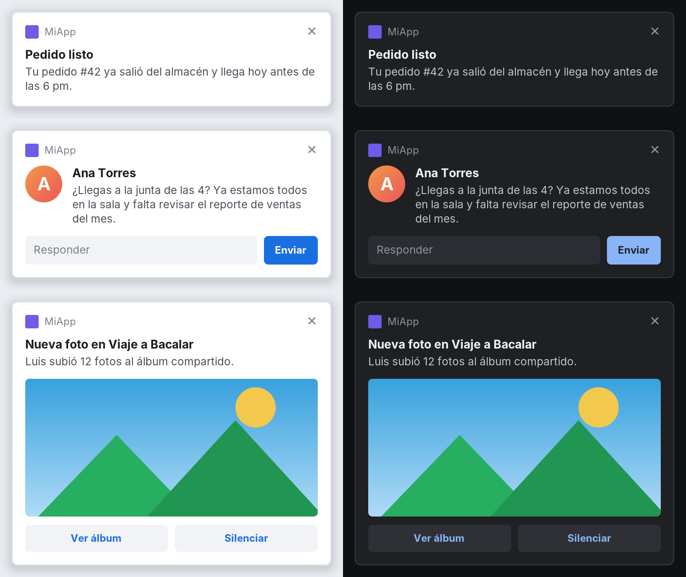
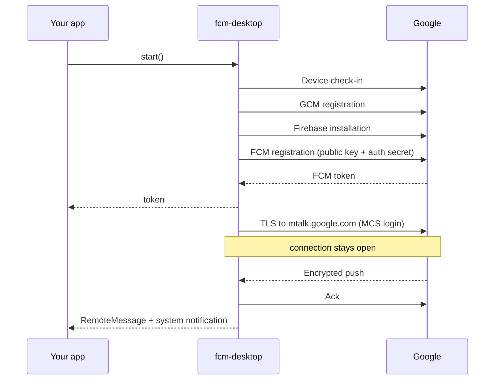

<div align="center">

# fcm-desktop

**Firebase Cloud Messaging push notifications for desktop (JVM)**<br>
The missing piece for Kotlin Multiplatform and Compose Desktop apps.

[](https://jitpack.io/#eliasmp07/fcm-desktop)


**English** · [Español](README.es.md)

</div>

---

Firebase ships messaging SDKs for Android, iOS and the web, but not for desktop. `fcm-desktop` fills that gap: it gives your desktop app a **regular FCM registration token** and delivers pushes in real time, so your backend sends to desktop exactly the way it already sends to Android and iOS.

```kotlin
val fcm = FcmDesktop(FirebaseDesktopOptions(projectId = "...", appId = "...", apiKey = "..."))

scope.launch { fcm.token.filterNotNull().collect { api.registerPushToken(it) } }
scope.launch { fcm.messages.collect { println("${it.notification?.title}: ${it.data}") } }

fcm.start()
```

> [!IMPORTANT]
> This is an unofficial library, not affiliated with Google or Firebase. It speaks the same protocol Chrome uses for web push, which Google does not document and may change. See [Limitations](#limitations).

## Features

- **Real FCM tokens**: works with the HTTP v1 API, the Admin SDK and the Firebase console.
- **`notification` and `data` messages**, with Web Push decryption (`aesgcm` and `aes128gcm`).
- **Rich notifications** built in: big picture, avatar, action buttons and inline reply, in light and dark themes.
- **System integration** when you want it: Windows toasts and Linux desktop notifications, with history and Do Not Disturb.
- **Native notifications** on Windows, macOS and Linux as the zero-setup default, or bring your own UI.
- **Coroutines-first API**: `StateFlow` for the token and connection state, `SharedFlow` for messages.
- **Stable token** across restarts, weekly refresh, and automatic re-registration if FCM drops the device.
- **Resilient connection**: heartbeats, exponential backoff with jitter, de-duplicated deliveries.
- **Tiny footprint**: only `kotlinx-coroutines-core` and `kotlinx-serialization-json`. No protobuf, no HTTP client, no native code.

## Contents

- [Installation](#installation)
- [Firebase setup](#firebase-setup)
- [Usage](#usage)
- [Rich notifications](#rich-notifications)
- [Sending messages](#sending-messages)
- [How it works](#how-it-works)
- [Limitations](#limitations)
- [Troubleshooting](#troubleshooting)
- [Testing](#testing)

## Installation

Add JitPack to your repositories:

```kotlin
// settings.gradle.kts
dependencyResolutionManagement {
    repositories {
        mavenCentral()
        maven("https://jitpack.io")
    }
}
```

Then add the dependency to your desktop source set:

```kotlin
// build.gradle.kts
kotlin {
    sourceSets {
        val desktopMain by getting {          // or jvmMain, depending on your target name
            dependencies {
                implementation("com.github.eliasmp07:fcm-desktop:v0.3.0")
            }
        }
    }
}
```

Requires JDK 11 or newer.

## Firebase setup

1. In the [Firebase console](https://console.firebase.google.com), open **Project settings → Your apps** and add a **Web** app (`</>`). Copy its `projectId`, `appId` and `apiKey`.
2. In **Google Cloud → APIs & Services → Credentials**, check that API key. It must be allowed to call the **Firebase Installations API** and the **FCM Registration API**, and it must not be restricted by HTTP referrer, Android app or iOS app (a desktop app cannot satisfy any of those).

No VAPID key is needed. When `vapidKey` is omitted, the FCM default key is used.

## Usage

### Quick start

```kotlin
val fcm = FcmDesktop(
    options = FirebaseDesktopOptions(
        projectId = "your-project",
        appId = "1:1234567890:web:abc123",
        apiKey = "AIza...",
    ),
    config = FcmDesktopConfig(appName = "MyApp"),
)

// Forward every emission to your backend: the token can change.
scope.launch {
    fcm.token.filterNotNull().collect { token -> api.registerPushToken(token, platform = "desktop") }
}

// Subscribe before start(): messages are not replayed.
scope.launch {
    fcm.messages.collect { message ->
        println("${message.notification?.title} -> ${message.data}")
    }
}

fcm.start()
```

### API overview

| Member | Description |
|---|---|
| `start()` | Registers on the first run, then connects and keeps listening. Idempotent. |
| `stop()` | Closes the connection. Pending pushes arrive on the next `start()`. |
| `getToken()` | Suspends until a token is available. Throws `FcmRegistrationException` on bad config. |
| `deleteToken()` | Unregisters the token from FCM and wipes the local registration. Call it on sign-out. |
| `close()` | Releases everything. The instance cannot be reused. |
| `token` | `StateFlow<String?>` with the current token. |
| `messages` | `SharedFlow<RemoteMessage>` with incoming pushes. |
| `connectionState` | `StateFlow<ConnectionState>`: `Stopped`, `Registering`, `Connecting`, `Connected`, `WaitingToReconnect`. |

### Compose Desktop

```kotlin
fun main() = application {
    val trayState = rememberTrayState()
    val fcm = remember {
        FcmDesktop(
            options = FirebaseDesktopOptions(projectId = "...", appId = "...", apiKey = "..."),
            config = FcmDesktopConfig(appName = "MyApp"),
            // Route notifications through the Compose tray instead of the default notifier.
            notifier = DesktopNotifier { n -> trayState.sendNotification(Notification(n.title, n.body)) },
        )
    }
    DisposableEffect(Unit) {
        fcm.start()
        onDispose { fcm.close() }
    }
    Tray(state = trayState, icon = painterResource("icon.png"))
    Window(onCloseRequest = ::exitApplication) { App() }
}
```

### Sharing code with Android and iOS

Keep your push abstraction in `commonMain` and back it with `FcmDesktop` on desktop:

```kotlin
// commonMain
interface PushService {
    val token: Flow<String>
    fun start()
}

// desktopMain
class DesktopPushService(private val fcm: FcmDesktop) : PushService {
    override val token: Flow<String> = fcm.token.filterNotNull()
    override fun start() = fcm.start()
}
```

### Notifications

Messages with a `notification` block are displayed automatically by `SystemDesktopNotifier`:

| OS | Backend |
|---|---|
| Windows | `java.awt.SystemTray`. Adds a tray icon; pass your own with `trayIcon` or `icon`. |
| macOS | Notification Center through `osascript` (attributed to "Script Editor"). |
| Linux | `notify-send`, falling back to the system tray. |

For pictures, buttons and replies use the built-in [rich notifications](#rich-notifications). To own the UI entirely, pass a custom `DesktopNotifier`, or `notifier = null` and render from `messages`. Data-only messages never display anything.

### Configuration

```kotlin
FcmDesktopConfig(
    appName = "MyApp",                  // credentials folder and notification title fallback
    showNotifications = true,           // auto-display `notification` payloads
    heartbeatIntervalMillis = 60_000,   // ping when the connection has been silent this long
    initialReconnectDelayMillis = 2_000,
    maxReconnectDelayMillis = 300_000,
)
```

Other extension points:

- **`CredentialStore`**: where the registration lives between runs. The default is a per-user file (`%APPDATA%`, `~/Library/Application Support` or `~/.config`). Implement it to use an encrypted store.
- **`FcmLogger`**: `FcmLogger.Stderr` (default), `FcmLogger.None`, or your own. Tokens and keys are never logged.

## Rich notifications

`java.awt.TrayIcon` can only show a title and a line of text. The library ships its own notification center, drawn by the app, with what Android notifications have: pictures, a sender avatar, action buttons and inline replies. It looks the same on Windows, macOS and Linux.

<p align="center"></p>

```kotlin
val center = DesktopNotificationCenter(
    NotificationCenterConfig(appName = "MyApp", appIcon = NotificationImage.Resource("icon.png")),
)

center.show(
    RichNotification(
        title = "Ana Torres",
        body = "Are you joining the 4 pm meeting?",
        largeIcon = NotificationImage.Url("https://example.com/ana.png"),
        image = NotificationImage.Url("https://example.com/photo.jpg"),
        actions = listOf(
            NotificationAction("Open chat") { openChat("ana") },
            NotificationAction("Mute") { mute("ana") },
        ),
        reply = NotificationReply(placeholder = "Reply") { text -> chat.send("ana", text) },
        onClick = { openChat("ana") },
    )
)
```

It works on its own for local notifications, and plugs into FCM with `RichDesktopNotifier`:

```kotlin
val fcm = FcmDesktop(
    options = options,
    notifier = RichDesktopNotifier(center) { push ->
        // Title, body and `notification.image` are mapped for you; add what the push needs.
        RichDesktopNotifier.defaultNotification(push).copy(
            reply = NotificationReply { text -> chat.send(push.message.data["chatId"], text) },
        )
    },
)
```

| Feature | How |
|---|---|
| Big picture | `image` |
| Avatar | `largeIcon`, shown round |
| App icon and name | `icon` / `appName`, or once in `NotificationCenterConfig` |
| Buttons | up to three `NotificationAction`s; `dismissOnClick = false` keeps it open |
| Inline reply | `NotificationReply`; Enter or the button sends |
| Update in place | `show()` again with the same `id` |
| Dismiss | `center.dismiss(id)`, `center.dismissAll()` |
| Timeout | `timeoutMillis` (`0` = sticky); pauses while hovered or while typing a reply |
| Result | `onDismiss` reports `Timeout`, `Closed`, `Clicked`, `Action`, `Replied` or `Cancelled` |
| Look | `theme` (light, dark, system), `accentColor`, `position`, `width`, `maxVisible` |

Images can come from a URL, a file, a classpath resource, raw bytes or an AWT image. They load in the background; downloads are limited to `http(s)`, 5 MB and 10 seconds. Pushes that share a collapse key replace each other, like notification tags on Android.

Things to know:

- Callbacks run on the AWT event thread. Launch a coroutine for anything slow.
- In-app windows are shown on the primary screen.

### System notifications: history and Do Not Disturb

By default the notifications are windows drawn by the library. Set `backend = NotificationBackend.Native` to hand them to the operating system instead, so they show up in its notification history and follow its Do Not Disturb / Focus setting:

```kotlin
val center = DesktopNotificationCenter(
    NotificationCenterConfig(
        appName = "MyApp",
        appIcon = NotificationImage.Resource("icon.png"),
        backend = NotificationBackend.Native,
    ),
)
```

The same `RichNotification` works with both backends. What each system can show:

| | Windows 10/11 | Linux (GNOME, KDE Plasma, ...) | macOS |
|---|---|---|---|
| Shown by | toast notifications | freedesktop.org notification service | in-app windows |
| History and Do Not Disturb | yes | yes | no |
| Big picture, avatar | yes | one picture (the big one wins) | yes |
| Action buttons | yes | yes | yes |
| Inline reply | yes | KDE Plasma only; elsewhere that notification uses an in-app window | yes |
| Replace by `id`, `dismiss` | yes | yes | yes |

A notification the system cannot show falls back to the in-app window, so nothing is dropped: that is everything on macOS (native rich notifications there need a signed app bundle and native code), and whatever the Linux desktop does not support.

Differences from the in-app backend:

- The OS draws them: `theme`, `position`, `width`, `accentColor` and `maxVisible` do not apply, and the OS decides how long a banner stays. `timeoutMillis = 0` asks for a persistent one.
- On Windows, pressing any button closes the toast, so `dismissOnClick = false` has no effect. `onDismiss` is not called when a banner merely times out, because the toast is still in the notification center.
- Windows needs the app to be registered: on first use the library writes a per-user registry key (`HKCU\Software\Classes\AppUserModelId\<appId>`) with the app name and icon. Pass `appId` to use the AppUserModelID of your installer's shortcut.
- Windows toasts go through a hidden Windows PowerShell helper process that lives as long as the center.
- Buttons and replies only work while the app is running. Afterwards the notifications stay in the history but are inert.
- Linux needs a JVM with Unix domain sockets (JDK 16+); older JVMs fall back to in-app windows.

> [!NOTE]
> The Linux backend is tested against a real D-Bus session bus. The Windows backend could not be run on Windows before release: its toast XML is unit-tested, the PowerShell helper is not. Please report what you see.

## Sending messages

Send to a desktop token like any other, for example with the HTTP v1 API:

```json
{
  "message": {
    "token": "<desktop token>",
    "notification": { "title": "Order ready", "body": "Your order #42 is on its way" },
    "data": { "orderId": "42" },
    "webpush": { "headers": { "TTL": "86400", "Urgency": "high" } }
  }
}
```

**Topics:** a desktop token cannot subscribe itself. Subscribe it from your server with the Admin SDK (`subscribeToTopic`).

## How it works

`fcm-desktop` registers the way a browser does when a site subscribes to web push, then listens on the same channel:



Payloads are end-to-end encrypted with keys generated on the device (Web Push encryption, RFC 8291). Decryption uses only the JDK.

## Limitations

- **Unofficial protocol.** Check-in, `register3`, Firebase Installations, FCM Registration and MCS are not public APIs. Google retired the previous registration API in June 2024, and it can happen again.
- **The app must be running.** There is no background delivery when the app is closed. Messages sent meanwhile arrive on reconnect, within their TTL.
- **Direct network access.** The connection goes straight to `mtalk.google.com` on port 5228, falling back to 443. HTTP proxies are not supported for that socket.
- **Custom VAPID keys are untested.** Prefer the default unless you need your own.
- **The registration file holds device private keys.** It is written with owner-only permissions where the OS supports it.

## Troubleshooting

| Symptom | Likely cause |
|---|---|
| `FcmRegistrationException` with status 400 | Wrong `projectId`, `appId` or `apiKey`. |
| `FcmRegistrationException` with status 401 or 403 | The API key is restricted, or the Firebase Installations / FCM Registration APIs are not enabled for it. |
| Stuck in `WaitingToReconnect` | A firewall or proxy blocks `mtalk.google.com` on 5228 and 443. |
| Token received but no pushes | Sending to an old token. Forward every emission of `token` to your backend. |
| No notification on Linux | `notify-send` is not installed and the desktop has no system tray. |

## Testing

```bash
./gradlew test
```

The suite covers three layers:

- **Wire format**: the hand-written protobuf codec matches `protobuf` byte for byte on the reference `.proto` files.
- **Encryption**: messages encrypted by Python's `http_ece` decrypt correctly, in both encodings and across multiple records.
- **Notifications**: text wrapping, image limits, card layout, and (when a display is available) stacking, queueing, timeouts, actions and replies on real windows.
- **System notifications**: the Windows toast XML, and the Linux backend against a real session bus with a fake notification service (`tools/fake_notification_server.py`, opt-in with `FCM_DESKTOP_DBUS_TEST=1`).
- **End to end**: a local fake of Google's servers (HTTP + MCS) drives registration, login, delivery, acks, duplicates, restarts, reconnection, heartbeats, re-registration, token refresh and deletion.

The suite runs offline: it does not talk to Google's real servers. Fixtures are regenerated with `python tools/generate_fixtures.py`.

## Acknowledgements

The protocol details were cross-checked against [firebase-messaging](https://github.com/sdb9696/firebase-messaging) (Python) and Chromium's GCM client.

## Contributing

Issues and pull requests are welcome. For protocol changes, please include a failing test or a capture that shows the new behaviour.
